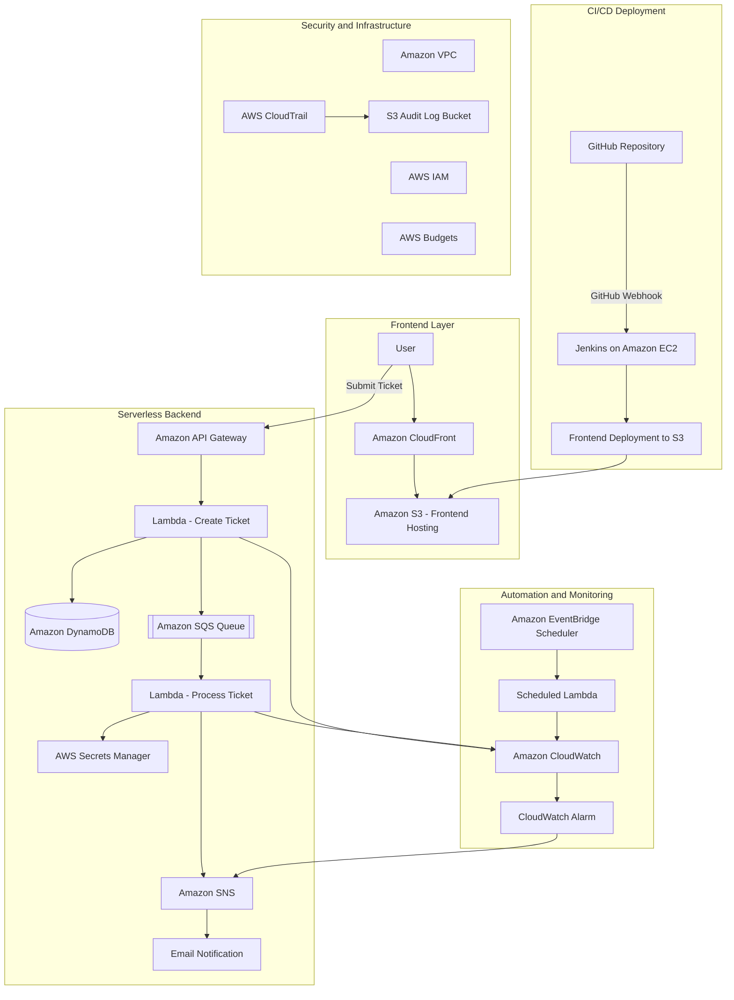

# AWS Serverless Support Ticket Management System

## 1. Project Overview

The AWS Serverless Support Ticket Management System is a cloud-based application that allows users to submit support tickets through a web interface. The application uses AWS serverless services to process ticket requests, store ticket information, and send email notifications.

This project demonstrates AWS cloud services, serverless architecture, asynchronous processing, automation, monitoring, security, and CI/CD implementation using Jenkins.

## 2. AWS Architecture

The architecture consists of a frontend layer, serverless backend, automation and monitoring components, and a CI/CD deployment pipeline.

**Note:** The custom VPC provides networking infrastructure for the Jenkins EC2 instance. The serverless application components are not deployed inside this VPC.

## 3. Working Application and API Endpoint

**Application URL:**  
https://d1twxic978qwzk.cloudfront.net

**API Gateway Base URL:**  
https://fy9vxbuge9.execute-api.us-east-1.amazonaws.com/dev

**Ticket Creation API:**

`POST https://fy9vxbuge9.execute-api.us-east-1.amazonaws.com/dev/tickets`

The frontend is hosted in Amazon S3 and delivered through Amazon CloudFront. API Gateway receives ticket requests and invokes the backend Lambda function.

## 4. AWS Services Used

| AWS Service | Purpose |
|---|---|
| Amazon S3 | Frontend hosting and CloudTrail audit log storage |
| Amazon CloudFront | Frontend content delivery |
| Amazon API Gateway | REST API for ticket creation |
| AWS Lambda | Ticket creation, processing and scheduled health checks |
| Amazon DynamoDB | Ticket information storage |
| Amazon SQS | Asynchronous ticket processing |
| Amazon SNS | Email and alarm notifications |
| Amazon EventBridge Scheduler | Scheduled health check automation |
| AWS Secrets Manager | Secure application configuration |
| Amazon CloudWatch | Logs, dashboard, metrics and alarms |
| AWS CloudTrail | AWS account activity auditing |
| AWS IAM | Roles and permissions management |
| Amazon VPC | Custom networking infrastructure |
| Amazon EC2 | Jenkins server hosting |
| AWS Budgets | Cost monitoring |

## 5. Application Workflow

1. The user opens the support ticket application through the CloudFront URL.
2. The user submits a support ticket through the frontend.
3. API Gateway receives the request and invokes the ticket creation Lambda function.
4. The Lambda function validates the request and stores ticket information in DynamoDB.
5. Ticket details are sent to the SQS queue.
6. The SQS event triggers the ticket processing Lambda function.
7. The processing Lambda retrieves the required configuration from Secrets Manager.
8. Amazon SNS sends an email notification to the subscribed email address.
9. CloudWatch collects Lambda logs and monitors application activity.

## 6. Networking Implementation

A custom Amazon VPC was configured with the following networking components:

- Public and private subnets.
- Internet Gateway.
- Route tables.
- Network configuration.
- Security groups.

An EC2 instance was deployed in the custom VPC to host Jenkins.

## 7. Security and Monitoring

The following security and monitoring configurations were implemented:

- IAM roles and policies for service-specific permissions.
- AWS Secrets Manager for secure application configuration.
- CloudWatch Logs for Lambda monitoring.
- CloudWatch dashboard to monitor Lambda functions.
- CloudWatch alarm to monitor Lambda errors and send notifications through SNS.
- CloudTrail to record AWS management events.
- AWS Budgets to monitor AWS spending.

## 8. CI/CD Implementation Using Jenkins

Jenkins was installed and configured on an Amazon EC2 instance to automate frontend deployment.

### Freestyle Job

**Job Name:** `support-ticket-frontend-build`

- Configured GitHub repository integration.
- Configured GitHub webhook trigger.
- Added shell commands to deploy frontend files to Amazon S3.
- Configured automatic builds after GitHub commits.

### Pipeline Job

**Job Name:** `support-ticket-deployment-pipeline`

The pipeline is defined using the root-level `Jenkinsfile`.

**Pipeline Stages:**

1. **Checkout:** Retrieves source code from GitHub.
2. **Verify Frontend:** Checks the frontend files.
3. **Deploy to S3:** Synchronizes frontend files with the S3 bucket.

The GitHub webhook triggers the Jenkins pipeline automatically when changes are pushed to the main branch.

## 9. Conclusion

This project demonstrates the implementation of an AWS Serverless Support Ticket Management System using multiple AWS services. It integrates serverless computing, asynchronous processing, database storage, email notifications, security, monitoring, networking, and Jenkins-based CI/CD automation.